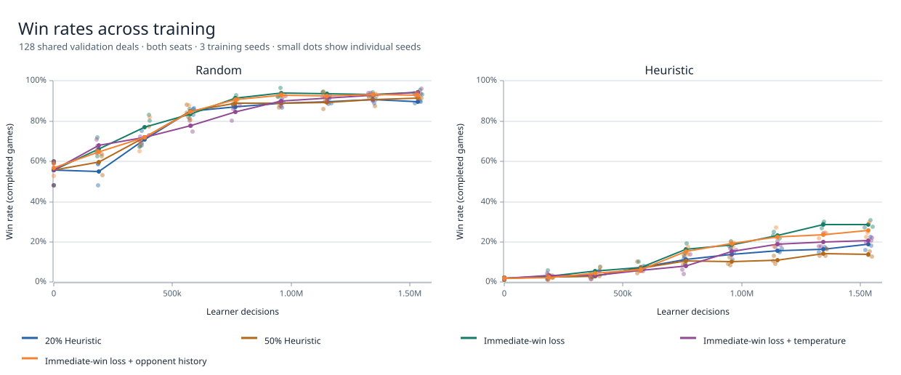
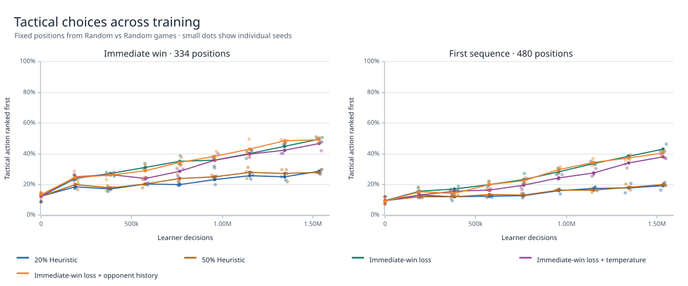

# Experiment catalog

The training presets record model and optimizer settings. The evaluation suite records the training seeds and shared panels. [Installation and run guide](../README.md) · [Evaluation suite config](../experiments/dqn-evaluation.json)

## Completed training experiments

All arms used Double DQN and seeds 42–44. Each run trained for 51,200 episodes. The temperature run for seed 42 continued to 148,480 episodes (4,171,829 learner decisions).

| Name | Config | Description |
| --- | --- | --- |
| 20% Heuristic opponents | [Training preset](../experiments/double-dqn-mixed-full.json) | Uses Heuristic opponents in 20% of training episodes and a periodically refreshed copy of the learner in the rest. |
| 50% Heuristic opponents | [Training preset](../experiments/double-dqn-half-heuristic-full.json) | Raises the Heuristic share to 50%. |
| Immediate-win supervision | [Training preset](../experiments/double-dqn-immediate-win-full.json) | Adds an auxiliary loss with weight 0.1 and a 0.1 Q-value margin to rank an immediate win above legal alternatives. Keeps the Heuristic share at 20%. |
| Temperature-controlled exploration | [Training preset](../experiments/double-dqn-temperature-full.json) | Keeps immediate-win supervision and samples legal actions from a softmax over their Q-values. The temperature anneals from 0.5 to 0.025 over 750,000 learner decisions. |
| Public move history | [Training preset](../experiments/double-dqn-history-full.json) | Adds the opponent’s last four public card plays and their board targets to the supervised model’s inputs. |

## Results

The table averages seeds 42–44 at the checkpoints nearest 1,533,464 learner decisions. Win rates use 128 shared validation deals, each played from both seats. The tactics columns report how often a move that wins immediately or claims the first sequence ranked first on fixed sets of 334 and 480 positions, respectively.

| Name | Win rates (Heuristic · Random) | Tactics immediate win | Tactics first sequence |
| --- | ---: | ---: | ---: |
| 20% Heuristic opponents | 19.0% · 89.7% | 28.5% | 19.2% |
| 50% Heuristic opponents | 13.9% · 91.7% | 28.0% | 19.9% |
| Immediate-win supervision | 28.6% · 94.3% | 49.8% | 43.3% |
| Temperature-controlled exploration | 20.8% · 94.3% | 46.6% | 38.1% |
| Public move history | 25.7% · 93.1% | 49.4% | 40.5% |

On the separate 256-deal holdout, the final public-history checkpoints won 23.0% against Heuristic and 94.5% against Random. The final supervised checkpoints averaged 26.4% and 95.5%. Both arms reached 1.54–1.57 million decisions per seed.

## Information set MCTS with frozen Double DQN

Greedy DQN and information set Monte Carlo tree search (ISMCTS) used the same seed-42 temperature checkpoint, `episode-148480.bpk`. Search samples the opponent hand and draw pile uniformly from unseen cards, uses greedy DQN for simulated opponent replies, and uses the frozen Q-values for action priors and leaf estimates. A 16-deal development panel compared 32 and 128 simulations per move. The 32-simulation budget won more games in both development matchups and was selected for the holdout, with a depth of two decisions for the searching player. [Search implementation](../crates/sequence-research/src/dqn/search.rs)

Each holdout deal was played twice with the policies swapping seats. Shuffle seeds ranged from 19,000,000 to 19,000,511, with an action limit of 512 and policy seeds 2090–2099 across the ten batches. The added 320 deals were evaluated after the initial 192. The 95% intervals use 10,000 bootstrap resamples with both seats kept together for each deal and bootstrap seed 20261125.

| Panel | ISMCTS wins vs. greedy DQN (95% CI) | ISMCTS wins vs. Heuristic | Greedy DQN wins vs. Heuristic | Gain vs. Heuristic (95% CI) |
| --- | ---: | ---: | ---: | ---: |
| Initial 192 deals | 58.6% (54.2–63.0%) | 42.4% | 29.4% | +13.0 pp (+7.6 to +18.2) |
| Added 320 deals | 63.3% (60.0–66.6%) | 40.8% | 28.8% | +12.0 pp (+7.7 to +16.3) |
| All 512 deals | **61.5% (58.9–64.2%)** | **41.4%** | **29.0%** | **+12.4 pp (+9.1 to +15.8)** |

The added panel reproduced the gains in both matchups for this checkpoint. In the serial head-to-head development run, the 32-simulation policy took 22.0 ms per decision at the median and 26.2 ms at the 95th percentile on CPU. Greedy DQN took 0.36 ms and 0.42 ms, respectively.

## Planned experiments

1. **Full-budget DQN vs. Double DQN.** Run seeds 42–44 using the [DQN preset](../experiments/dqn-mixed-full.json) and compare to the completed [Double DQN baseline](../experiments/double-dqn-mixed-full.json). Then consider a DQN batch with the same 0.1 tactical loss to complete a two-by-two comparison of target algorithm and supervision.
2. **Zeroed history control.** Train the public history model with `move_history` set to `zeroed`. Compare at matched learner-decision counts to measure the effect of public move history with the model dimensions held fixed.
3. **Older self-play checkpoints.** Train with a pool of older self-play checkpoints while keeping the Heuristic share at 20%. Evaluate generalization against a defense-heavy Heuristic and frozen checkpoints from other seeds.
4. **Stronger immediate-win loss.** In a copy of the [supervised preset](../experiments/double-dqn-immediate-win-full.json), set `immediate_win_loss_weight` to 0.2 and keep the margin and opponent mix fixed. Compare tactical ranking and unaided game win rates against the completed 0.1 runs.
